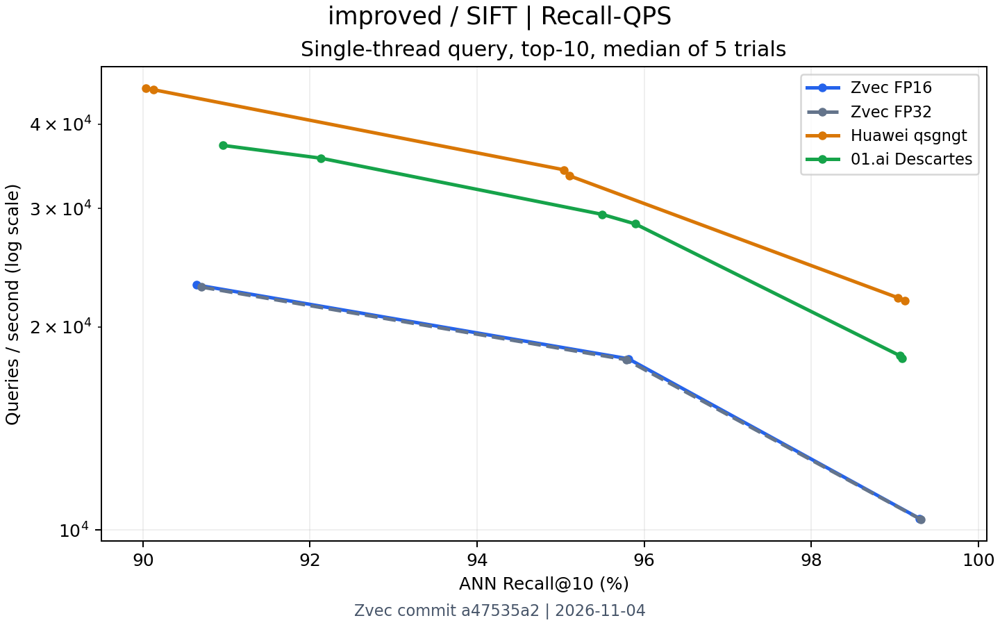
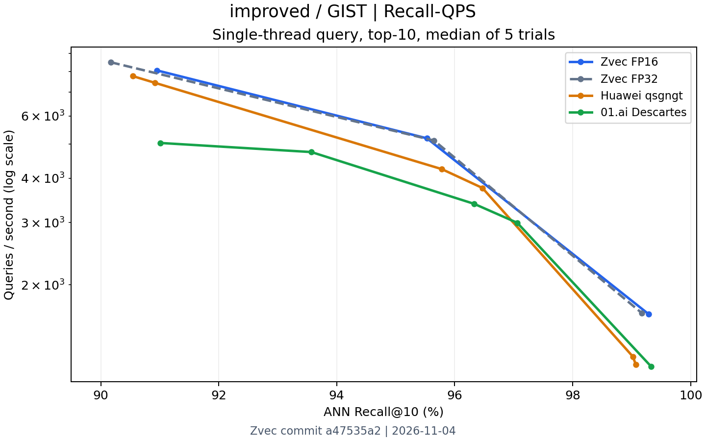
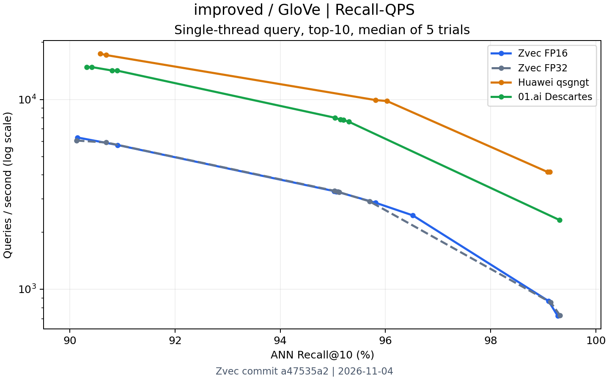

# QuantizedGraph FP16 性能与内存测试报告

[查看 HTML 版](REPORT_FP16.zh-CN.html)

测试日期：2026-11-04。比较 Zvec QuantizedGraph FP16、Huawei qsgngt 与 01.ai Descartes，并增加同版本 Zvec FP32 作为精度对照。

## 结论与使用边界

以下结论仅针对本机、已扫描的配置和对应召回下限，实际召回率随配置列出。各算法的图度数、索引体积及构建成本不同，没有施加相同内存预算。

- SIFT：三档召回下，FP16 相对同版本 FP32 的 QPS 变化为 +0.3% 至 +0.7%，总查询 RSS 减少 9.5% 至 9.6%。
- GIST：三档召回下，FP16 相对同版本 FP32 的 QPS 变化为 -5.1% 至 +1.4%，总查询 RSS 减少 13.9% 至 13.9%。
- GloVe：三档召回下，FP16 相对同版本 FP32 的 QPS 变化为 -0.3% 至 +3.8%，总查询 RSS 减少 8.1% 至 8.8%。

## 召回率与 QPS

单元格第一行为 QPS，第二行为实际官方 ANN Recall@10 与查询后进程 RSS。RSS 包含统一加载的完整基础数据及测试框架。每个召回档选取达到下限的最快已确认配置，QPS 为预热后 5 轮测量的中位数；粗体为包含 FP32 对照在内的该行最高值。不同列不是精确相同召回率；不同召回档可能选择不同建图配置，因此内存也可能改变。

| 数据集 | 召回下限 | Zvec FP16 | Zvec FP32 | Huawei qsgngt | 01.ai Descartes |
| --- | --- | --- | --- | --- | --- |
| SIFT | ≥90% | 23,090 90.643% · 2.26 GiB RSS | 22,922 90.703% · 2.50 GiB RSS | **45,220** 90.036% · 6.21 GiB RSS | 37,193 90.961% · 5.30 GiB RSS |
| SIFT | ≥95% | 17,945 95.811% · 2.28 GiB RSS | 17,885 95.787% · 2.52 GiB RSS | **34,216** 95.042% · 6.22 GiB RSS | 29,391 95.496% · 5.31 GiB RSS |
| SIFT | ≥99% | 10,395 99.299% · 2.28 GiB RSS | 10,366 99.313% · 2.52 GiB RSS | **22,099** 99.041% · 6.22 GiB RSS | 18,124 99.066% · 5.32 GiB RSS |
| GIST | ≥90% | 8,068 90.950% · 11.05 GiB RSS | **8,505** 90.170% · 12.84 GiB RSS | 7,775 90.540% · 13.86 GiB RSS | 5,033 91.010% · 11.01 GiB RSS |
| GIST | ≥95% | **5,187** 95.530% · 11.06 GiB RSS | 5,113 95.650% · 12.84 GiB RSS | 4,247 95.780% · 13.87 GiB RSS | 3,388 96.330% · 11.02 GiB RSS |
| GIST | ≥99% | 1,653 99.290% · 11.06 GiB RSS | **1,667** 99.170% · 12.84 GiB RSS | 1,255 99.020% · 13.87 GiB RSS | 1,177 99.330% · 11.02 GiB RSS |
| GloVe | ≥90% | 6,306 90.141% · 2.48 GiB RSS | 6,077 90.127% · 2.69 GiB RSS | **17,444** 90.573% · 7.01 GiB RSS | 14,824 90.317% · 7.01 GiB RSS |
| GloVe | ≥95% | 3,289 95.026% · 2.47 GiB RSS | 3,300 95.033% · 2.71 GiB RSS | **9,925** 95.816% · 7.01 GiB RSS | 8,013 95.041% · 7.02 GiB RSS |
| GloVe | ≥99% | 866 99.103% · 2.50 GiB RSS | 852 99.143% · 2.72 GiB RSS | **4,147** 99.085% · 7.02 GiB RSS | 2,313 99.314% · 7.03 GiB RSS |

## FP16 相对 FP32 的取舍

吞吐变化为 FP16 / FP32 − 1；内存与磁盘节省为 1 − FP16 / FP32。正的节省值表示占用减少。小幅 QPS 差异应结合轮间波动解读，不能直接视为统计显著提升。两种精度采用相同构建参数独立建图，量化及并行插入可能改变图结构，因此不把差异全部归因于单次距离计算。

| 数据集 | 召回下限 | QPS 变化 | 总查询 RSS 节省 | 增量 RSS 节省 | 索引磁盘节省 |
| --- | --- | --- | --- | --- | --- |
| SIFT | ≥90% | +0.7% | 9.6% | 12.2% | 31.1% |
| SIFT | ≥95% | +0.3% | 9.5% | 12.1% | 31.1% |
| SIFT | ≥99% | +0.3% | 9.5% | 12.1% | 31.1% |
| GIST | ≥90% | -5.1% | 13.9% | 19.4% | 45.0% |
| GIST | ≥95% | +1.4% | 13.9% | 19.4% | 45.0% |
| GIST | ≥99% | -0.8% | 13.9% | 19.4% | 45.0% |
| GloVe | ≥90% | +3.8% | 8.1% | 10.0% | 27.7% |
| GloVe | ≥95% | -0.3% | 8.8% | 10.8% | 27.7% |
| GloVe | ≥99% | +1.7% | 8.1% | 10.0% | 27.7% |

## 内存与存储

下表对应 ≥95% 召回档的配置，单位均为 GiB（2³⁰ 字节）。RSS 包含进程实际驻留的匿名内存和文件映射页；基线包含完整基础数据、查询集及测试框架，所有算法按相同口径加载。增量 RSS = 查询后 RSS − 加载索引前的基线 RSS，并非严格的独占索引内存。加载/查询峰值按 0.2 秒间隔采样；查询峰值覆盖该测试配置的整个参数扫描过程，并非只对应 ≥95% 档的一次查询。

| 数据集 | 算法 | 索引磁盘 | 基线 RSS | 加载后 RSS | 查询后 RSS | 增量 RSS | 加载峰值 RSS | 查询峰值 RSS | 借用基础向量 |
| --- | --- | --- | --- | --- | --- | --- | --- | --- | --- |
| SIFT | Zvec FP16 | 0.53 | 0.54 | 2.18 | 2.28 | 1.73 | 2.18 | 2.34 | 0.00 |
| SIFT | Zvec FP32 | 0.77 | 0.54 | 2.42 | 2.52 | 1.97 | 2.42 | 2.58 | 0.00 |
| SIFT | Huawei qsgngt | 6.50 | 0.54 | 6.13 | 6.22 | 5.67 | 6.13 | 6.28 | 0.00 |
| SIFT | 01.ai Descartes | 5.37 | 0.54 | 5.23 | 5.31 | 4.77 | 5.27 | 5.37 | 0.00 |
| GIST | Zvec FP16 | 2.19 | 3.64 | 11.03 | 11.06 | 7.42 | 11.03 | 11.06 | 0.00 |
| GIST | Zvec FP32 | 3.97 | 3.64 | 12.82 | 12.84 | 9.20 | 12.82 | 12.85 | 0.00 |
| GIST | Huawei qsgngt | 20.04 | 3.64 | 13.85 | 13.87 | 10.23 | 13.85 | 13.87 | 3.58 |
| GIST | 01.ai Descartes | 11.09 | 3.64 | 11.00 | 11.02 | 7.38 | 11.43 | 11.02 | 0.00 |
| GloVe | Zvec FP16 | 0.55 | 0.51 | 2.39 | 2.47 | 1.96 | 2.38 | 2.55 | 0.00 |
| GloVe | Zvec FP32 | 0.76 | 0.51 | 2.60 | 2.71 | 2.20 | 2.60 | 2.77 | 0.00 |
| GloVe | Huawei qsgngt | 7.16 | 0.51 | 6.93 | 7.01 | 6.50 | 6.93 | 7.08 | 0.00 |
| GloVe | 01.ai Descartes | 7.20 | 0.51 | 6.94 | 7.02 | 6.51 | 7.39 | 7.08 | 0.00 |

> Huawei GIST 适配器借用框架中的 FP32 基础向量；这部分已经包含在总 RSS 中，但不在增量 RSS 中。因此不能把该行增量 RSS 单独当作部署内存。比较整体运行开销时查看总 RSS，同时参考基线与借用向量列。Zvec 的量化图缓存于加载阶段在内存中生成，磁盘索引大小不包含这部分缓存。FP16 主要减少原始向量存储，图边、路由和量化缓存不会全部减半。

## Zvec 构建内存

以下为本次新建索引的进程树峰值 RSS，每 0.2 秒采样；构建并发最多 2。该指标包含构建器及训练阶段的内存，和查询 RSS 的数据驻留口径不同。构建期间存在其他构建/编译工作，因此不将耗时作为隔离的构建速度对比；厂商原始建图峰值本轮未重测。

| 数据集 | 存储精度 | 索引磁盘 GiB | 构建峰值 RSS GiB |
| --- | --- | --- | --- |
| SIFT | FP16 | 0.528 | 1.208 |
| SIFT | FP32 | 0.766 | 1.445 |
| GIST | FP16 | 2.187 | 5.945 |
| GIST | FP32 | 3.975 | 7.733 |
| GloVe | FP16 | 0.551 | 1.223 |
| GloVe | FP32 | 0.763 | 1.433 |

## 三个数据集的曲线

曲线展示官方 ANN Recall@10 与 QPS（对数轴）；内存和磁盘数据见上面的表格。

### SIFT

### GIST

### GloVe

## 实现和验证

FP16 索引保留半精度向量；候选精排直接读取 FP16 存储，以原始 FP32 查询进行 FP32 累加。支持 Cosine 与 Squared L2，覆盖 FP16 路由训练、保存加载、查询过滤、搜索预算、原生批量查询，以及普通线性和分组回退路径。

测试提交 `a47535a2a7cac05c039ae50cb99cb046a6062a1b`，代码基线 `13b7bdf8eeea5279e87655cfe0cfc95a1b2949a1`；测试代码指纹 `afda0145fff58298ee1d7084fa2635de4a9c1db1c34e60c3fdac7a80bbfa9a89`。184 项 C++ 回归测试全部通过；三个数据集 × 两种精度共 6 项 CLI 构建、重开与精确结果检查通过；不启用 RaBitQ 的编译路径亦通过。测试过程未跳过硬件支持相关用例。

88 个确认点及 36 个对比单元格已与标准 ANN-Benchmarks HDF5 记录交叉核对，包括重新计算官方召回、五轮中位数、返回 ID 指纹、版本归属与 RSS 算术关系。

## 测试协议

完整基础数据：SIFT 为 1,000,000 × 128 维；GIST 为 1,000,000 × 960 维；GloVe 为 1,183,514 × 100 维。

- 全量查询：SIFT 10,000，GIST 1,000，GloVe 10,000；TopK=10，非 batch；调用 ANN-Benchmarks 的 run_individual_query。
- 正式查询串行执行，绑定 CPU 0，库线程限制为 1；所有构建结束后才开始正式计时。构建任务最大并发 2，每个任务 4 个物理核，高内存的 GIST 构建分开排队。
- 官方 ANN 召回按返回候选真实距离与 ground truth 第 10 近邻距离 + 0.001 比较；距离评估使用原始基础向量。逐配置检查 ID 范围、唯一性及 5 轮返回 ID 的稳定性。
- 公开查询集同时用于参数选择与报告，没有独立盲测集。GloVe 小 ef_search 的访问表溢出造成明显变慢后，两种精度均采用 ef_search=2048（接口上限） 继续精细扫描；已完成扫描记录保留，最终确认点均重新预热并测量五轮。GloVe FP16/FP32 在 95% 附近按相同插值规则补测两个 bucket_width 的局部参数点，以缩小原始网格造成的实际召回差距。所有厂商 QPS 在本次重新测量，未复用历史吞吐。
- Zvec FP32/FP16 索引本次重新构建。厂商复用已验证的原始图，重新加载及初始化查询缓存；加载峰值不能视为厂商从零构建的峰值。
- Huawei GloVe 使用 a2 图及 Q=1 量化配置，其存储成本与原始 Q=2 配置不同。01.ai 分别传入 M64/S1/L256 与 M128/S3/L448（GIST 仅前者），并在独立目录中复测；配置表记录的是接口传入值。SIFT 两组加载的缓存目录标签均为 64，GloVe 均为 96，GIST 为 32。这些接口参数不能直接当作已验证的实际图度数，M64/M128 配置名称也不证明加载了不同度数的图。

CPU：Intel(R) Xeon(R) 6982P-C。全部确认点的最大轮间 QPS 变异系数为 0.83%。不同召回档的精确参数、各轮 QPS、索引路径和标准 HDF5 位置均保存在原始数据中。

发布测试环境：`improved`；ANN-Benchmarks 工作区提交 `c909bc7d5c45a1af01622dba1c276ff662ee7904`。Huawei 发行仓库提交 `6681f15c895441791e8d22abe53e866e2c4dc936`；01.ai 发行仓库提交 `da6c2ae2a685ad806ee420e3f15db812c0084797`。本轮使用独立的源码、构建、索引缓存和结果目录，运行前校验源码、二进制和评估代码的指纹。

## ≥95% 档构建接口参数

| 数据集 | 算法 | 配置 |
| --- | --- | --- |
| SIFT | Zvec FP16 | `{"index_type":"kHNSW","data_type":"DT_FP32","metric_type":"kL2sq","dimension":128,"m":32,"ef_construction":400,"use_id_map":true,"use_quantized_graph":true,"quantizer_param":{"type":"kFP16"}}` |
| SIFT | Zvec FP32 | `{"index_type":"kHNSW","data_type":"DT_FP32","metric_type":"kL2sq","dimension":128,"m":32,"ef_construction":400,"use_id_map":true,"use_quantized_graph":true}` |
| SIFT | Huawei qsgngt | `{"edge":100,"epsilon":0.08,"ifES":0,"indegree":120,"max_edge":96,"outdegree":64,"paramE":[400,400,12,10,250],"paramS":[100,100,60],"range":200,"rangeMax":200,"sample":5000,"searchA":400,"threshold":60,"Q":1}` |
| SIFT | 01.ai Descartes | `{"M":64,"S":1,"L":256}` |
| GIST | Zvec FP16 | `{"index_type":"kHNSW","data_type":"DT_FP32","metric_type":"kL2sq","dimension":960,"m":50,"ef_construction":500,"use_id_map":true,"use_quantized_graph":true,"quantizer_param":{"type":"kFP16"}}` |
| GIST | Zvec FP32 | `{"index_type":"kHNSW","data_type":"DT_FP32","metric_type":"kL2sq","dimension":960,"m":50,"ef_construction":500,"use_id_map":true,"use_quantized_graph":true}` |
| GIST | Huawei qsgngt | `{"edge":40,"epsilon":0.001,"ifES":0,"indegree":40,"max_edge":64,"outdegree":48,"paramE":[400,400,12,10,250],"paramS":[100,100,60],"range":175,"rangeMax":175,"sample":1000,"searchA":400,"threshold":60,"Q":3,"era":1}` |
| GIST | 01.ai Descartes | `{"M":64,"S":1,"L":256}` |
| GloVe | Zvec FP16 | `{"index_type":"kHNSW","data_type":"DT_FP32","metric_type":"kCosine","dimension":100,"m":32,"ef_construction":400,"use_id_map":true,"use_quantized_graph":true,"quantizer_param":{"type":"kFP16"}}` |
| GloVe | Zvec FP32 | `{"index_type":"kHNSW","data_type":"DT_FP32","metric_type":"kCosine","dimension":100,"m":32,"ef_construction":400,"use_id_map":true,"use_quantized_graph":true}` |
| GloVe | Huawei qsgngt | `{"edge":120,"epsilon":0.1,"ifES":0,"indegree":120,"max_edge":96,"outdegree":64,"paramE":[400,400,12,10,250],"paramS":[100,100,60],"range":175,"rangeMax":175,"sample":5000,"searchA":400,"threshold":60,"Q":1}` |
| GloVe | 01.ai Descartes | `{"M":64,"S":1,"L":256}` |

### 01.ai 加载缓存的身份记录

以下是实际使用的基础图目录标签，不能仅依据传入的 M 参数推断实际图度数。原始文件头和大小另保存在原始记录中。本轮重新加载、初始化查询缓存并测量 QPS。

| 测试配置名称 | 接口参数 | 实际加载的缓存目录标签 |
| --- | --- | --- |
| gist-descartes-m64 | {"M": 64, "S": 1, "L": 256} | basefng.square_l2.1000000.960.32 |
| glove-descartes-m128 | {"M": 128, "S": 3, "L": 448} | basefng.square_l2.1183514.100.96 |
| glove-descartes-m64 | {"M": 64, "S": 1, "L": 256} | basefng.square_l2.1183514.100.96 |
| sift-descartes-m128 | {"M": 128, "S": 3, "L": 448} | basefng.square_l2.1000000.128.64 |
| sift-descartes-m64 | {"M": 64, "S": 1, "L": 256} | basefng.square_l2.1000000.128.64 |

### 各召回档查询参数与五轮 QPS 范围

QPS 列依次为五轮最小值 / 中位数 / 最大值。参数扫描和选择使用同一公开查询集。

| 数据集 | 召回下限 | 算法 | 实际召回 | QPS 最小 / 中位 / 最大 | 查询参数 |
| --- | --- | --- | --- | --- | --- |
| SIFT | ≥90% | Zvec FP16 | 90.643% | 23,013 / 23,090 / 23,289 | `{"index_type":"kHNSW","ef_search":512,"quantized_graph_margin":0.0408,"quantized_graph_bucket_width":0.002,"quantized_graph_route_beam":1,"quantized_graph_max_expansions":2048}` |
| SIFT | ≥90% | Zvec FP32 | 90.703% | 22,853 / 22,922 / 23,036 | `{"index_type":"kHNSW","ef_search":512,"quantized_graph_margin":0.0408,"quantized_graph_bucket_width":0.002,"quantized_graph_route_beam":1,"quantized_graph_max_expansions":2048}` |
| SIFT | ≥90% | Huawei qsgngt | 90.036% | 44,996 / 45,220 / 45,340 | `[1,2,1.0175,5,1,0]` |
| SIFT | ≥90% | 01.ai Descartes | 90.961% | 37,163 / 37,193 / 37,234 | `[0,15]` |
| SIFT | ≥95% | Zvec FP16 | 95.811% | 17,912 / 17,945 / 18,018 | `{"index_type":"kHNSW","ef_search":512,"quantized_graph_margin":0.076,"quantized_graph_bucket_width":0.002,"quantized_graph_route_beam":1,"quantized_graph_max_expansions":2048}` |
| SIFT | ≥95% | Zvec FP32 | 95.787% | 17,836 / 17,885 / 17,954 | `{"index_type":"kHNSW","ef_search":512,"quantized_graph_margin":0.076,"quantized_graph_bucket_width":0.002,"quantized_graph_route_beam":1,"quantized_graph_max_expansions":2048}` |
| SIFT | ≥95% | Huawei qsgngt | 95.042% | 33,984 / 34,216 / 34,554 | `[1,2.5,1.05,0,1,0]` |
| SIFT | ≥95% | 01.ai Descartes | 95.496% | 29,271 / 29,391 / 29,455 | `[0,21]` |
| SIFT | ≥99% | Zvec FP16 | 99.299% | 10,376 / 10,395 / 10,422 | `{"index_type":"kHNSW","ef_search":512,"quantized_graph_margin":0.136,"quantized_graph_bucket_width":0.002,"quantized_graph_route_beam":1,"quantized_graph_max_expansions":2048}` |
| SIFT | ≥99% | Zvec FP32 | 99.313% | 10,346 / 10,366 / 10,367 | `{"index_type":"kHNSW","ef_search":512,"quantized_graph_margin":0.136,"quantized_graph_bucket_width":0.002,"quantized_graph_route_beam":1,"quantized_graph_max_expansions":2048}` |
| SIFT | ≥99% | Huawei qsgngt | 99.041% | 21,831 / 22,099 / 22,399 | `[1,3,1.115,0,1,0]` |
| SIFT | ≥99% | 01.ai Descartes | 99.066% | 17,990 / 18,124 / 18,150 | `[2,29]` |
| GIST | ≥90% | Zvec FP16 | 90.950% | 7,984 / 8,068 / 8,091 | `{"index_type":"kHNSW","ef_search":2048,"quantized_graph_margin":0.08,"quantized_graph_bucket_width":0.002,"quantized_graph_route_beam":1,"quantized_graph_max_expansions":2048}` |
| GIST | ≥90% | Zvec FP32 | 90.170% | 8,467 / 8,505 / 8,528 | `{"index_type":"kHNSW","ef_search":512,"quantized_graph_margin":0.076,"quantized_graph_bucket_width":0.002,"quantized_graph_route_beam":1,"quantized_graph_max_expansions":2048}` |
| GIST | ≥90% | Huawei qsgngt | 90.540% | 7,658 / 7,775 / 7,804 | `[4,8,1.02,0,1,3]` |
| GIST | ≥90% | 01.ai Descartes | 91.010% | 5,002 / 5,033 / 5,050 | `[3,100]` |
| GIST | ≥95% | Zvec FP16 | 95.530% | 5,155 / 5,187 / 5,195 | `{"index_type":"kHNSW","ef_search":2048,"quantized_graph_margin":0.1,"quantized_graph_bucket_width":0.002,"quantized_graph_route_beam":1,"quantized_graph_max_expansions":2048}` |
| GIST | ≥95% | Zvec FP32 | 95.650% | 5,087 / 5,113 / 5,118 | `{"index_type":"kHNSW","ef_search":2048,"quantized_graph_margin":0.1,"quantized_graph_bucket_width":0.002,"quantized_graph_route_beam":1,"quantized_graph_max_expansions":2048}` |
| GIST | ≥95% | Huawei qsgngt | 95.780% | 4,217 / 4,247 / 4,280 | `[8,14,1.02,0,1,3]` |
| GIST | ≥95% | 01.ai Descartes | 96.330% | 3,366 / 3,388 / 3,391 | `[0,100]` |
| GIST | ≥99% | Zvec FP16 | 99.290% | 1,652 / 1,653 / 1,663 | `{"index_type":"kHNSW","ef_search":2048,"quantized_graph_margin":0.152,"quantized_graph_bucket_width":0.002,"quantized_graph_route_beam":1,"quantized_graph_max_expansions":2048}` |
| GIST | ≥99% | Zvec FP32 | 99.170% | 1,663 / 1,667 / 1,669 | `{"index_type":"kHNSW","ef_search":2048,"quantized_graph_margin":0.152,"quantized_graph_bucket_width":0.002,"quantized_graph_route_beam":1,"quantized_graph_max_expansions":2048}` |
| GIST | ≥99% | Huawei qsgngt | 99.020% | 1,249 / 1,255 / 1,259 | `[28,60,1.02,0,1,3]` |
| GIST | ≥99% | 01.ai Descartes | 99.330% | 1,174 / 1,177 / 1,181 | `[0,300]` |
| GloVe | ≥90% | Zvec FP16 | 90.141% | 6,293 / 6,306 / 6,318 | `{"index_type":"kHNSW","ef_search":2048,"quantized_graph_margin":0.08,"quantized_graph_bucket_width":0.004,"quantized_graph_route_beam":1,"quantized_graph_max_expansions":8192}` |
| GloVe | ≥90% | Zvec FP32 | 90.127% | 6,061 / 6,077 / 6,079 | `{"index_type":"kHNSW","ef_search":2048,"quantized_graph_margin":0.08,"quantized_graph_bucket_width":0.004,"quantized_graph_route_beam":1,"quantized_graph_max_expansions":8192}` |
| GloVe | ≥90% | Huawei qsgngt | 90.573% | 17,408 / 17,444 / 17,471 | `[1,3,1.09,0,1,1]` |
| GloVe | ≥90% | 01.ai Descartes | 90.317% | 14,784 / 14,824 / 14,862 | `[2,20]` |
| GloVe | ≥95% | Zvec FP16 | 95.026% | 3,284 / 3,289 / 3,295 | `{"index_type":"kHNSW","ef_search":2048,"quantized_graph_margin":0.10816,"quantized_graph_bucket_width":0.004,"quantized_graph_route_beam":1,"quantized_graph_max_expansions":8192}` |
| GloVe | ≥95% | Zvec FP32 | 95.033% | 3,294 / 3,300 / 3,301 | `{"index_type":"kHNSW","ef_search":2048,"quantized_graph_margin":0.1,"quantized_graph_bucket_width":0.016,"quantized_graph_route_beam":1,"quantized_graph_max_expansions":8192}` |
| GloVe | ≥95% | Huawei qsgngt | 95.816% | 9,856 / 9,925 / 9,958 | `[1,3,1.13,0,1,1]` |
| GloVe | ≥95% | 01.ai Descartes | 95.041% | 7,999 / 8,013 / 8,018 | `[2,40]` |
| GloVe | ≥99% | Zvec FP16 | 99.103% | 866 / 866 / 867 | `{"index_type":"kHNSW","ef_search":2048,"quantized_graph_margin":0.16,"quantized_graph_bucket_width":0.004,"quantized_graph_route_beam":1,"quantized_graph_max_expansions":8192}` |
| GloVe | ≥99% | Zvec FP32 | 99.143% | 852 / 852 / 853 | `{"index_type":"kHNSW","ef_search":2048,"quantized_graph_margin":0.16,"quantized_graph_bucket_width":0.004,"quantized_graph_route_beam":1,"quantized_graph_max_expansions":8192}` |
| GloVe | ≥99% | Huawei qsgngt | 99.085% | 4,137 / 4,147 / 4,163 | `[1,4,1.18,0,1,1]` |
| GloVe | ≥99% | 01.ai Descartes | 99.314% | 2,310 / 2,313 / 2,315 | `[3,80]` |

## 原始测量归档

归档编号：`improved_fp16_20261104`。完整归档保留对比 CSV、88 个确认点、标准 ANN-Benchmarks HDF5、逐轮 QPS、内存采样、构建记录、回归测试及源码/二进制指纹。本文已列出所选配置的实际召回、查询参数和五轮 QPS 范围；三张图保存在同目录的 `results/` 中。
