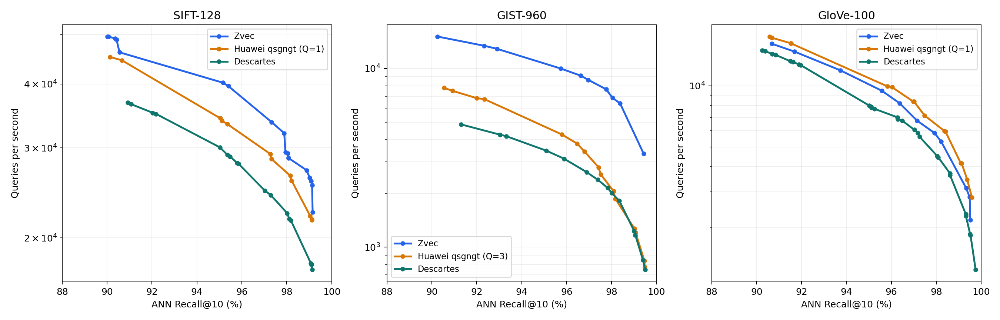

# 构建、检索配置与验证记录

本目录的 `config/` 保存各数据集的构建、查询配置，`results/` 保存按批次归档的报告、曲线和汇总数据。最近更新：2026-11-03。
“最佳”限定为已有参数扫描和指定快照上的最佳已测选择，不保证任意机器、新建图或数据分布均最优。

FP32/FP16 的统一配置与精度语义见 [存储精度说明](FP16.zh-CN.md)。
当前构建配置在 C++ 中训练量化参数并持久化量化块，无需外部码本文件；历史表有单独的日期标题。

## 配置选择

| 场景 | 构建配置 | 检索配置 |
|---|---|---|
| Cohere FP32，嵌入路由 | [cohere_fp32_build.yaml](config/cohere_fp32_build.yaml) | [cohere_fp32_recall_bench.yaml](config/cohere_fp32_recall_bench.yaml) |
| GIST FP32，嵌入路由 | [gist_fp32_build.yaml](config/gist_fp32_build.yaml) | [gist_fp32_recall_bench.yaml](config/gist_fp32_recall_bench.yaml) |
| Cohere FP16，嵌入路由 | [cohere_fp16_build.yaml](config/cohere_fp16_build.yaml) | [cohere_fp16_recall_bench.yaml](config/cohere_fp16_recall_bench.yaml) |
| GIST FP16，嵌入路由 | [gist_fp16_build.yaml](config/gist_fp16_build.yaml) | [gist_fp16_recall_bench.yaml](config/gist_fp16_recall_bench.yaml) |
| GloVe FP32，双视图 | [glove_fp32_build.yaml](config/glove_fp32_build.yaml) | [glove_fp32_recall_bench.yaml](config/glove_fp32_recall_bench.yaml) |
| SIFT FP32，单/双视图 | [原始图](config/sift_fp32_base_build.yaml) → [单视图](config/sift_fp32_v1_build.yaml) / [双视图](config/sift_fp32_v2_build.yaml) | [sift_fp32_recall_bench.yaml](config/sift_fp32_recall_bench.yaml) |

GloVe 的数据准备、七档查询 sweep、两种召回定义与资源说明见 [GloVe 最佳实践](GLOVE.zh-CN.md)。

文件名中的 `fp32` / `fp16` 表示数据库存储精度，接口输入均为 FP32。各组配置使用独立的工作索引、dump 和召回日志路径。旧的 `cohere_build.yaml`、`cohere_recall_bench.yaml`、`gist_build.yaml`、`gist_recall_bench.yaml` 也保留在 `config/` 中；已有命令需要在配置路径中补上 `config/`。

检索参数以对应精度的 YAML 为准，必须与新构建的量化快照配套。
以下为 2026-10-30 **原生编码**的历史参数，不能套用于新训练的码本：

| 参数 | Cohere FP32 嵌入路由 | GIST FP32 嵌入路由 |
|---|---:|---:|
| ef_search | 64 | 2048 |
| margin | 0.001 | 0.085 |
| bucket_width | 0.004 | 0.002 |
| max_expansions | 64 | 256 |
| route_beam | 1 | 1 |
| uncertainty_bonus | 0.15 | 0 |

新建图按数据集和存储精度选择对应配置。
Cohere/GIST 构建为 M=50、ef_construction=500，SIFT/GloVe 为 M=32、ef_construction=400；入口树 seed=202610261259，训练型码本 seed=20261031，路由尺寸见[算法说明](ALGORITHM.zh-CN.md)及对应 YAML。
固定 seed 不保证多线程图构建在所有运行中逐字节一致，重建后必须先检查召回。

## 使用仓库工具

先按仓库构建说明配置 Release 构建目录，再构建本地工具：

```bash
cmake --build build --target local_builder recall bench -j8
```

将 YAML 中 `/data/<dataset>` 替换为本机路径。`BuildFile` 必须是 local_builder 使用的
`.zvec.vecs` 格式；不能把 fvecs 或文本文件仅改后缀使用。查询与 GT 都是文本：

```text
查询：0;0.12 0.34 ...
GT：  0;142594 34736 ...
```

查询每行包含完整维度的 FP32 值；GT 后面是按精确距离排序的文档 key，前10项用于 Recall@10。
Cohere/GloVe 使用 cosine 转换器；SIFT/GIST 保留 L2 原始值，不做 cosine 归一化。
为构建选择新的 `IndexPath` 和 `DumpPath`，检索配置的 `IndexPath` 指向构建后的 `DumpPath`。

```bash
./build/bin/local_builder tools/core/bench/config/cohere_fp32_build.yaml
./build/bin/recall tools/core/bench/config/cohere_fp32_recall_bench.yaml
./build/bin/bench tools/core/bench/config/cohere_fp32_recall_bench.yaml

./build/bin/local_builder tools/core/bench/config/gist_fp32_build.yaml
./build/bin/recall tools/core/bench/config/gist_fp32_recall_bench.yaml
./build/bin/bench tools/core/bench/config/gist_fp32_recall_bench.yaml
```

构建成功应包含 `Router trained for embedded snapshot`、`SymQG codec trained` 和
`Quantized graph prepared for embedded snapshot` 日志。加载应包含 `quantized_graph snapshot load done`。
检索不会补训练缺失模型。新码本的随机初始化和原离线 Python 训练器不同，不要求参数字节与旧文件一致；
应重新校准搜索 margin，在召回达标后比较 QPS。
`QueryParam` 是 JSON 字符串；`QueryParams` 列表会覆盖它，常规单配置不要额外添加该列表。
原生吞吐测试的线程数、轮次和时长由对应 YAML 的 `BenchThreadCounts`、`BenchRounds`、`BenchSecs` 指定。
先确认 Recall@10≥90%，再比较同硬件、同快照、同参数和线程数下的 QPS。
在本次机器上使用 `taskset -c 0,2,4,6,8,10,12,14`；换机器应先核对物理核拓扑，不能机械照抄。

## SIFT 数据准备与两阶段构建

SIFT-128 使用原始 L2 向量和零起始行 ID。通用导出脚本需要 Python 3、`numpy`、`h5py`，
适用于 SIFT、GIST 和 GloVe 的稠密 HDF5；`prepare_glove.py` 保留为限定 100 维的兼容入口。
以下命令从同一个原始图生成单视图和双视图，便于比较视图数的影响：

```bash
python3 tools/core/bench/prepare_hdf5.py \
  /data/sift/sift-128-euclidean.hdf5 /data/sift --include-train
./build/bin/txt2vecs --input=/data/sift/train.txt \
  --output=/data/sift/sift-base.zvec.vecs --dimension=128 --method=L2
./build/bin/local_builder tools/core/bench/config/sift_fp32_base_build.yaml
./build/bin/local_builder tools/core/bench/config/sift_fp32_v1_build.yaml
./build/bin/local_builder tools/core/bench/config/sift_fp32_v2_build.yaml
./build/bin/recall tools/core/bench/config/sift_fp32_recall_bench.yaml
./build/bin/bench tools/core/bench/config/sift_fp32_recall_bench.yaml
```

已有 `.zvec.vecs` 时省略 `--include-train`，并跳过 `txt2vecs`。导出脚本不会覆盖已有文件。
查询配置的 `IndexPath` 指明对应的视图快照；常规使用只需构建该视图。
SIFT 查询 preset 根据保存快照的严格 ID Recall@10 ≥90% 档选择，新建图后须再次校准召回。
原始图配置不持久化量化块，后续 v1/v2 配置通过 `InputIndex` 训练匹配的路由并保存量化快照。

## local_builder 一次完成构建、训练与保存

正常新建直接执行上面的 `*_build.yaml`：`local_builder` 依次完成 HNSW 建图、入口树训练、量化参数训练、
量化块生成和快照保存。训练与保存共用工具内的一条收尾流程，不需要额外转换命令或转换配置文件。

四组构建配置共用 `QuantizedGraph` 节，FP32/FP16 和距离类型由索引元数据决定，C++ 实现不按数据集名称分流。
当前 Cohere 使用 `global`、Hadamard 6 维分块、32 个邻居；GIST 使用 `low_rank`、Gaussian 8 维分块、秩 8、64 个邻居。
`TrainingSamples` 是数据库邻域采样上限，默认 1024；`CenterWeight` 是对拟合偏移的收缩系数，不是直接写死中心权重。
低秩模式支持秩 8/16/32；Gaussian 分块支持 4/6/8，Hadamard 分块支持 6/8；删去整个 `Codec` 节可保留原生编码。

如果已经有原生 HnswStreamer 快照并希望复用原图，在同一份构建配置中将 `BuilderCommon.BuildFile` 换成
`BuilderCommon.InputIndex: /path/to/existing.index`，并指定尚不存在的 `DumpPath`。
此时向量精度、维度和距离类型由输入快照决定，工具跳过向量插入，继续执行相同的训练、量化和保存流程。
`InputIndex` 和 `BuildFile` 互斥；复用已有路由树时省略 `QuantizedGraphRouter`，需要重新训练时保留该节。

`Codec` 的参数、量化邻接块、局部系数和入口数据写入索引，重载不依赖外部模型或 `QG_*` 环境变量。
新格式为不可变快照；修改向量或图结构后重建。旧索引没有量化块时保留兼容的加载时编码流程。
训练参数采用合法范围检查，未知字段报错，避免拼写错误静默退回原生编码。

## 可选多视图构建

在原有构建 YAML 的 `QuantizedGraph` 中添加 `RotationViews: 2`（也支持 4），并保留 `Persist: true`。
省略该字段或设为 1 时保持历史行为；无需修改查询配置或设置环境变量。切换后重新校准 margin。
例如：

```yaml
QuantizedGraph:
  Persist: true
  RotationViews: 2
  MaxNeighbors: 64
  ThreadCount: 2
  Codec:
    Type: native
QuantizedGraphRouter:
  Anchors: 65536
  ProjectedDimension: 64
  Seed: 202610261259
```

示例路由投影适用于 100 维实验，其他数据使用各自的投影配置。
从带路由的原生图通过 `InputIndex` 转换时，更改视图数必须重建匹配的路由，保留 `QuantizedGraphRouter` 节。
请使用尚未持久化量化块的原生图作为重训路由的输入，并写入新的 `DumpPath`。
已保存的多视图量化索引可以直接加载，不需原图、训练向量或额外模型文件。

## 2026-11-03 SIFT / GIST / GloVe 性能与厂商对照记录

本轮在 ANN-Benchmarks 中补齐三数据集三算法，完整报告、严格 ID 召回表、曲线和参数见 [测试报告](results/20261103-three-datasets/REPORT_ZH.md)。
构建任务并发上限为 **2**；正式查询等待建图结束后串行、固定 CPU 0，TopK=10，全量预热 1 轮后测 5 轮并取中位数。
SIFT/GloVe 各 10,000 条查询，GIST 1,000 条。下表为 **QPS / 实际 ANN Recall@10**，各列取达到同一召回下限的最快已确认配置。

| 数据集 | ANN 召回下限 | Zvec FP32 | Huawei qsgngt | Descartes |
|---|---:|---:|---:|---:|
| SIFT | ≥90% | 49,514 / 90.008% | 45,165 / 90.124% | 36,749 / 90.922% |
| SIFT | ≥95% | 40,218 / 95.158% | 34,263 / 95.042% | 30,063 / 95.020% |
| GIST | ≥90% | 15,097 / 90.250% | 7,792 / 90.540% | 4,861 / 91.310% |
| GIST | ≥95% | 9,996 / 95.740% | 4,277 / 95.780% | 3,466 / 95.100% |
| GloVe | ≥90% | 16,120 / 90.686% | 17,505 / 90.573% | 14,950 / 90.243% |
| GloVe | ≥95% | 9,459 / 95.578% | 9,955 / 95.816% | 7,987 / 95.024% |

ANN 召回带绝对距离容差 0.001，与严格 ID 召回有区别。实际召回不完全相同，吞吐倍率仅表示同一召回下限档的比较。
同一公开查询集用于扫描与报告；各算法使用各自的构建配置，未约束相同索引内存预算。
Zvec 使用通用实现 `6ae49f65`：GIST 单视图、GloVe 双视图；SIFT 从同一原始图构建单/双视图，逐目标选择已确认的快者。
Huawei 的 GloVe 配置为 a2 原始图加 Q=1 量化层；原 Q=2 的低召回诊断不纳入对照表，配置差异与验证记录见完整报告。
Cohere 的历史验证单独保留在下节。



- [完整查询参数和协议](config/annbenchmark_three_datasets.yaml)、[汇总 CSV](results/20261103-three-datasets/comparison.csv)。
- [严格 ID Recall/QPS](results/20261103-three-datasets/recall-qps-strict.png)、[可重绘的确认点](results/20261103-three-datasets/points.json)。
- [SIFT 原生 recall 配置复核](results/20261103-three-datasets/native-cli-audit.json)：文本入口与 ANN 运行器使用的同一配置得到相同严格召回。

## 2026-11-03 多视图跨数据集验证

在同一源 HNSW 图上比较单视图和双视图，数据库均为 FP32。
Cohere/GIST 各使用 100 万条数据和 1,000 条查询，GloVe 使用 1,183,514 条数据和全部 10,000 条查询。
分别保留既有 global/Hadamard-6、low_rank/Gaussian-8/rank-8、native codec，仅改变视图数并生成匹配路由。
搜索参数分别粗扫/细扫，以严格 ID Recall@10 选点；在已有查询集调参与复核，不宣称盲测。
固定 CPU 0、单查询单线程，预热后每进程 5 轮，按 1→2→2→1 顺序确认，以下为合计 10 轮中位数。
双视图点的召回不低于单视图点；两者都达到 90%。

| 数据集 | Recall 单→双 | QPS 单→双 | 双/单 | 索引 GiB 单→双 |
|---|---:|---:|---:|---:|
| Cohere-768 cosine | 90.03% → 90.05% | 41,964 → 34,856 | 0.831× | 6.373 → 8.280 |
| GIST-960 L2 | 90.26% → 90.55% | 14,306 → 11,050 | 0.772× | 9.518 → 13.333 |
| GloVe-100 cosine | 90.098% → 90.131% | 12,167 → 15,150 | 1.245× | 2.950 → 4.078 |

在 ≥95% 且双视图召回不低于单视图的确认点上，Cohere 双/单为 0.816×，GIST 为 0.719×；
GIST ≥99% 为 0.634×。GloVe 本轮单视图网格没有达到 95%，不做该档比较，也不将其解释为召回上限。
这些是本地 Python→C++ 单次查询口径，计时不含召回统计；不要与历史原生 bench 或官方排行榜 QPS 直接相除。

因此默认继续使用 `RotationViews: 1`；双视图作为显式可选能力合入通用路径。
当前测得 GloVe 受益；在 Cohere/GIST 的现有学习 codec 上，增加视图反而降速。
三组索引空间分别增长约 29.9%、40.1%、38.3%，不能把更多视图视为无成本优化。

37 项 C++ 测试及 10 项 CLI 检查通过，覆盖 1/2/4 视图、三类 codec、FP32/FP16、两种距离、
768 维特殊变换、MMAP/BufferPool 重载、损坏元数据拒绝、从原始向量新建和非法配置检查；
`RABITQ_SUPPORTED=0` 核心封装通过 `-Werror` 编译。
旧单视图快照在旧库和新库下的三组参数返回 ID 完全一致（三数据集共九组）；
GloVe 原型四组参数各 10,000 条查询在正式双视图索引上逐项复现，未设置原型环境开关。
ANN benchmark 默认并行度保持 2；本次大索引构建串行，计时进程互斥，避免 OOM 和相互干扰。

本机完整配置、每轮样本、结果 ID、编译命令和报告保存在
`~/bench/quantized_graph/rotation_views_generalization_20261103/`。

## 2026-10-31 自动训练与持久化回归

比较同一原生 HNSW 图上的离线码本持久化版本与 C++ 构建时自动训练版本。使用官方 local_builder、recall、bench。
构建参数不读取测试查询/GT；检索 margin 在每数据集已有的 1,000 条开发查询上重新校准。
GIST 在既有 5,000 条复核查询上验证，Cohere 为同一组 1,000 条查询；不宣称全新盲测。
本机为 Xeon 6982P-C，KVM 暴露 8 核/16 逻辑线程，固定 CPU 集合。ABBA 四进程，每进程每线程 2轮×4秒，以下为每版本每线程4个样本的中位数。

| 数据集 / 存储 | Recall@10 对照→自动训练 | 1线程 QPS 对照→自动训练 | 8线程 QPS 对照→自动训练 | 最终 margin |
|---|---:|---:|---:|---:|
| gist_fp16 | 90.654% → 90.868% | 14,141 → 14,478 | 110,139 → 114,497 | 0.0485 |
| gist_fp32 | 90.864% → 91.162% | 13,555 → 13,980 | 108,202 → 110,076 | 0.049 |
| cohere_fp16 | 90.210% → 90.280% | 51,351 → 51,732 | 418,377 → 423,942 | 0.0057 |
| cohere_fp32 | 90.800% → 90.850% | 45,072 → 46,138 | 385,888 → 395,316 | 0.00560416667 |

四组召回均不低于对照，QPS 中位数未下降。运行间有波动，不将这些小幅差异解释为新的算法突破。
Cohere FP32 单线程波动较大，另以固定单核、每进程6秒预热后连续两轮6秒的 ABBA 复核：
1线程中位数 45,789→47,841 QPS；8线程 393,451→393,537 QPS，基本持平。该补测与主表口径不同，不跨表相除。

另外完成了两数据集×两精度从原始向量完整新建 2,048 条数据的训练/dump/load 验证；31项量化图回归、
19项错误配置检查、稀疏 ID/小维度/退化数据和独立数值检查均通过。RABITQ_SUPPORTED=0/1 的核心封装均通过 -Werror 编译检查。
最终查询与测试二进制和回归时逐字节相同。所有构建/加载验证均不需要外部码本，加载测试还设置了无效的旧研究环境变量来检查隔离。

原始配置、日志、完整中文报告和所有计时样本保存于本机 `~/bench/quantized_graph/builder_training_20261031/`，不加入 Git。
报告明确区分百万图转换验证与小规模从头构建；前者保持源图不变，后者验证完整构建链路。

## 2026-10-30 原生编码实测（历史）

硬件为 Intel Xeon 6982P-C，8物理核/16逻辑线程，AVX-512。
使用官方 `recall` 与 `bench`、1000条查询、Top10、单查询 API。
以下来自当前嵌入路由百万快照；前后使用同一快照，各版本各线程4个样本，中位数为：

| 数据集 | Recall@10 | 单线程 QPS | 8线程 QPS | 搜索 RSS 约值 |
|---|---:|---:|---:|---:|
| Cohere | 90.09% | 50,557 | 403,086 | 7.63 GiB |
| GIST | 90.15% | 12,113 | 96,653 | 9.19 GiB |

该轮对照比较“内存复用版”与“内存复用+桶范围修正版”：Cohere QPS变化+0.23%/+0.01%，
GIST +0.08%/+0.31%，基本持平；Cohere召回不变，GIST从90.07%升到90.15%。
这只是当前观测，不将小幅波动宣称为独立加速。

## 内存优化消融

另一次同场 ABBA（旧版/新版/新版/旧版）只取消 FP32 副本，尚未加入桶范围修正：

| 数据集 | Recall 前→后 | 单线程 QPS 前→后 | 8线程 QPS 前→后 | RSS 前→后 |
|---|---|---:|---:|---:|
| Cohere | 90.09%→90.09% | 41,370→42,743 | 382,095→386,848 | 10.55→7.63 GiB（-27.67%） |
| GIST | 90.07%→90.07% | 11,454→11,614 | 92,286→93,581 | 12.77→9.19 GiB（-28.01%） |

两组分别验证了内存优化及后续范围修正的“不降低召回、QPS下降不超过5%”要求。
上述两次测试时间不同，不能跨表用绝对 QPS 差计算加速。
RSS 取 `/proc/PID/status` 搜索期间样本，不是 PSS、整机占用或磁盘大小，未清空 page cache。

## 相对 bucket90_w16 的累计改进

使用原冻结 Cohere 1M 图和匹配的 C++ 外部模型，双方主查询 Recall@10均为90.32%。
旧算法保持冻结的图搜索、桶、旋转和旧 AVX-512 算术，通过接口兼容在相同现代官方工具中复现。
最终基线去掉了适配器中的临时因子复制，避免人为增加旧版成本。

| 线程 | 冻结算法复现版 QPS | 当前 QPS | 中位数提升 | 当前最慢轮 / 基线最快轮提升 |
|---|---:|---:|---:|---:|
| 1 | 33,534.65 | 49,622.15 | +47.97% | +43.65% |
| 8 | 267,380.20 | 392,061.10 | +46.63% | +46.14% |

ABBA四个独立进程，每进程各线程3轮×6秒，共每版本每线程6个样本，全部保留。
旧版使用 ef800、width=.016、margin=.02、cap64、默认入口；该次实验的完整配置和命令保存在本地归档
`bucket90_audit_20261030/zero_copy_paired/`。
旧基线10000个有序ID与历史一致，分数符合官方文本输出精度；原冻结二进制也另行复现。
没有把不同 benchmark 的 QPS 相除。这约47%是路由、中心估计、精排、内核等累计改进，
不能归因于本轮两项修改，也不是相对更新后的 `34f2f19a` 再提升20%的证明。

## 额外查询与正确性

第一次数据库内额外查询暴露了近零入口桶范围退化：非自身召回89.62%，修正后95.75%。
该查询组已用于诊断，只作为回归。代码及参数冻结后，seed=202610300901重新均匀抽取1000个数据库 ID，
排除上一组全部 ID，以穷举距离和候选 FP64 重排生成 GT，未再据此调参：

| 新查询协议 | 冻结算法复现版 Recall@10 | 当前 Recall@10 |
|---|---:|---:|
| 标准 Top10，GT包含自身 | 96.42% | 96.02% |
| 请求Top11，返回后去自身并取Top10 | 96.44% | 95.83% |

两组均通过≥90%的预设门槛，但当前召回不等于旧版。第二行不是搜索时过滤；这些是数据库向量查询，
不是 IID 独立文本测试集。主1000条查询也已参与长期选参，不称为盲测。

98项相关测试全部通过：接口81、visit1、bucket7、integer/router6、kernel3。
新增测试覆盖 Cosine/L2 在 buffer pool 和 mmap 重开后 ID/分数一致，以及零、负、极小入口距离时的
桶排序、下界和正常尺度不变。既有过滤预算、小上限、精排与路由回归继续通过。
复现这些测试可运行：

```bash
cmake --build build --target index_interface_test quantized_graph_visit_set_test quantized_graph_bucket_test quantized_graph_integer_center_test turbo_symqg_kernels_test -j8
./build/bin/index_interface_test
./build/bin/quantized_graph_visit_set_test
./build/bin/quantized_graph_bucket_test
./build/bin/quantized_graph_integer_center_test
./build/bin/turbo_symqg_kernels_test
```

内存阶段还用官方 `local_builder` 为两数据集各新建2048条向量的小索引，训练、dump、load后比较100条查询，
前后16个结果文件一致；它只证明小规模端到端集成，不是重建百万图的性能证明。
当前主性能测试均使用固定百万快照，避免重建图差异干扰归因。

## 归档与复现边界

历史验收阶段再次构建工具并运行上述98项测试，全部通过。当时使用三组检索配置（含归档的冻结图对照），
召回复核分别为 Cohere 90.09%、GIST 90.15%、Cohere 冻结图90.32%。配置语法和文档内相对链接检查通过。
重新构建的 `bench`、`recall`、`libcore_knn_hnsw.so` 的 SHA256 与性能验收时完全相同；
上述历史验收没有再次计时，沿用已验证二进制的 ABBA 结果。

原始数据、模型、库、日志和全部计时不提交仓库。本次机器的本地归档位于 `~/bench/quantized_graph/`：

- `cleanup_commit_20261030/`：提交前构建日志、98项测试及三份配置的召回复核。
- `bucket90_audit_20261030/`：最终报告、数学说明、逐项审计、源码/二进制哈希。
- `bucket90_audit_20261030/zero_copy_paired/`：最终冻结基线对照的 YAML、命令、日志和全部样本。
- `bucket90_audit_20261030/range_current_validation/`：当前 Cohere/GIST 配置回归。
- `bucket90_audit_20261030/fresh_database_queries/`：新查询、GT及生成协议。
- `memory_reuse_20261029/`：内存消融、存储回归与小规模构建验证。
- `ablation_20261027/standard_tools/`：历史入口开/关消融；不混入本轮提升计算。

冻结对照使用 `research_20261025/indexes/cohere1m_m50_efc500.index` 与
`router_cpp_20261027/router384_snapshot_final.bin`；当前推荐配置对应
`embedded_router_20261028/{cohere,gist}_full.index`。这些本地归档不随 Git 提供。
没有归档图/模型对时，使用本目录构建配置生成新的嵌入路由快照，再测召回与性能，不能宣称复现了上述具体数字。
