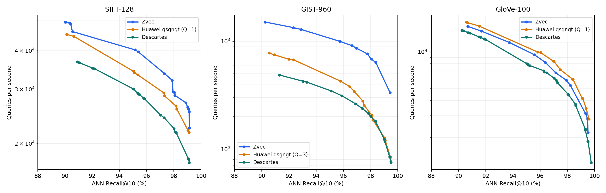
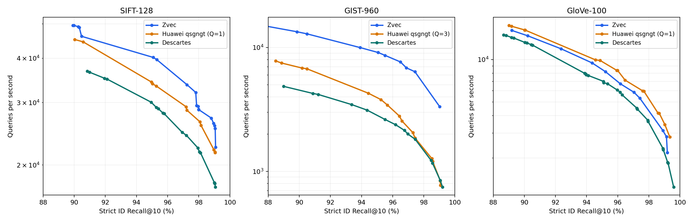

# SIFT / GIST / GloVe 三方 ANN-Benchmarks 测试报告

测试日期：2026-11-03。补齐 SIFT 三方和 GloVe Huawei，并在同一轮重新测量 GIST、GloVe 的对照查询。以下仅采用本轮正式确认结果。

## 结果：ANN-Benchmarks Recall@10

单元格为 **QPS / 实际召回率**；每个目标档选本轮扫描中达到该召回下限的最快已确认配置。QPS 为 5 轮中位数，越高越好。

| 数据集 | 召回下限 | Zvec FP32 | Huawei qsgngt | Descartes | Zvec/Huawei | Zvec/Descartes |
|---|---:|---:|---:|---:|---:|---:|
| SIFT | ≥90% | 49,514 / 90.008% | 45,165 / 90.124% | 36,749 / 90.922% | 1.096× | 1.347× |
| SIFT | ≥95% | 40,218 / 95.158% | 34,263 / 95.042% | 30,063 / 95.020% | 1.174× | 1.338× |
| GIST | ≥90% | 15,097 / 90.250% | 7,792 / 90.540% | 4,861 / 91.310% | 1.937× | 3.106× |
| GIST | ≥95% | 9,996 / 95.740% | 4,277 / 95.780% | 3,466 / 95.100% | 2.337× | 2.884× |
| GloVe | ≥90% | 16,120 / 90.686% | 17,505 / 90.573% | 14,950 / 90.243% | 0.921× | 1.078× |
| GloVe | ≥95% | 9,459 / 95.578% | 9,955 / 95.816% | 7,987 / 95.024% | 0.950× | 1.184× |

## 结果：严格 ID Recall@10

该口径只计与 ground truth 前 10 个 ID 的交集，用于区分距离容差带来的额外召回；等距离的其他 ID 也不计入该交集。

| 数据集 | 召回下限 | Zvec FP32 | Huawei qsgngt | Descartes |
|---|---:|---:|---:|---:|
| SIFT | ≥90% | 49,082 / 90.259% | 45,165 / 90.037% | 36,749 / 90.839% |
| SIFT | ≥95% | 40,218 / 95.070% | 33,907 / 95.025% | 29,047 / 95.281% |
| SIFT | ≥99% | 25,813 / 99.011% | 21,738 / 99.052% | 17,840 / 99.002% |
| GIST | ≥90% | 12,886 / 90.500% | 6,829 / 90.180% | 4,263 / 90.870% |
| GIST | ≥95% | 9,114 / 95.070% | 3,798 / 95.250% | 2,631 / 95.500% |
| GIST | ≥99% | 3,334 / 99.020% | 840 / 99.060% | 845 / 99.060% |
| GloVe | ≥90% | 14,755 / 90.220% | 16,232 / 90.027% | 13,240 / 90.035% |
| GloVe | ≥95% | 8,211 / 95.209% | 8,380 / 95.943% | 7,004 / 95.085% |
| GloVe | ≥99% | 2,828 / 99.132% | 3,456 / 99.029% | 1,865 / 99.207% |

## SIFT 单视图与双视图

两种快照使用同一个原始 HNSW 图；各档分别选择达到 ANN 召回下限的最快已确认配置。单元格为 QPS / 实际 ANN Recall@10。

| ANN 召回下限 | 单视图 | 双视图 | 双/单视图 QPS |
|---|---:|---:|---:|
| ≥90% | 46,120 / 90.551% | 49,514 / 90.008% | 1.074× |
| ≥95% | 37,042 / 95.025% | 40,218 / 95.158% | 1.086× |
| ≥99% | 22,961 / 99.109% | 26,230 / 99.019% | 1.142× |

SIFT 保存的单视图索引为 2.614 GiB，双视图为 3.568 GiB。该视图比较包含各自的参数选择，不代表所有参数不变时的单因素加速。

各列的实际召回不一定完全相同；倍率是同一召回下限档的吞吐比，不表示精确相同召回下的加速。全部 90/95/97/98/99% 档及参数见 [comparison.csv](comparison.csv) 和 [summary.json](summary.json)。

## 测试方法

- 环境：本机 ANN-Benchmarks `.venv-leaders`，非 Docker；Python 3.10、NumPy 1.26.4，厂商原生二进制与官方 Python 适配器。
- 构建任务最大并发 **2**，每任务分配 4 个物理核，两个核集合互不重叠；设置 OMP_NUM_THREADS=4，Zvec/NGT 显式指定 4 个构建线程，厂商内部串行阶段依照其实现执行。正式计时在所有构建结束后串行执行，固定 CPU 0，库线程限制为 1。
- 全量查询、TopK=10、单查询非 batch。粗扫只用于选参数；正式结果调用仓库 `ann_benchmarks.runner.run_individual_query`，每个配置全量预热 1 轮，再测 5 轮，保存中位数轮的标准 HDF5。
- ANN 召回：返回候选的真实距离 ≤ ground truth 第 10 近邻距离 + 0.001 的比例；严格 ID 召回：返回 ID 与 ground truth 前 10 个 ID 的交集比例。
- 正式结果均检查 ID 范围、唯一性、同进程 5 轮 ID 稳定性，并从落盘 HDF5 重新计算两种召回和 QPS。Descartes 重新初始化可能重新生成 PQ 缓存，跨初始化的召回不能视为固定不变。
- 每个配置保留 5 轮 QPS；本轮最大轮间变异系数为 4.01%，详见确认点中的 `trial_qps` 和 [结果复核](audit.json)。
- 同一公开查询集用于参数扫描与报告，没有独立盲测集。本报告是有限配置下的本机结果，不代表厂商最佳配置或官方排行榜。
- 各算法使用各自的构建配置，图度数、索引大小和构建成本不相同，未按相同内存预算约束；本表比较这些已测配置的查询吞吐。CPU 型号与虚拟化信息见 [cpu.json](cpu.json)。

| 数据集 | 数据条数 | 查询数 | 维度 | 距离 |
|---|---:|---:|---:|---|
| sift | 1,000,000 | 10,000 | 128 | euclidean |
| gist | 1,000,000 | 1,000 | 960 | euclidean |
| glove | 1,183,514 | 10,000 | 100 | angular |

## 构建与版本

- Zvec：分支 `feat/quantized-graph-performance-exploration` 的被测提交 `0013c771feac1125104a478cd5e8e86fe3cdb606`；原生库由通用化代码 `6ae49f65` 构建，后续提交为配置/文档。
- SIFT：新建 M32 / efConstruction400 原始 HNSW 图，分别生成单视图和双视图；native codec、MaxNeighbors64、65536 anchors、64 维投影。两种视图均扫描，逐目标选快者。
- GIST：复用已验证的正式单视图 FP32 索引，M50 / efConstruction500、low_rank Gaussian-8/rank-8 codec、8192 anchors、256 维投影。GloVe：复用正式双视图 FP32 索引和已验证 presets。
- Huawei：SIFT 使用官方 a1，GIST 复用 a4。GloVe 使用 a2 原始图，量化参数从 Q=2 调整为 Q=1 后重新构建量化层（明确标记为 a2-q1），其余图构建参数不变；因此不是未经修改的官方 a2 配置。按 angular 适配器使用 `-DE`（NormalizedL2）构建，返回 ID 按原始数据的 cosine 距离评估。
- GloVe 的原始 Q=2 量化层出现低召回及跨初始化波动，未纳入正式性能结论；全量对象和抽样图边距离审计正常，归一化 init_obj 未解决问题。Q=1 复测恢复高召回；现有证据尚不足以确定 Q=2 的二进制内部根因。诊断和配置差异见 [GloVe Huawei 验证记录](glove-qsg-validation.json)。
- Q=1 增加了 GloVe Huawei 的量化存储成本：子空间数量由 50 增至 100，量化图文件约由 2.56 GiB 增至 4.76 GiB。实际目录大小见验证记录和各确认点元数据；各算法使用各自的索引预算。
- SIFT 的 Huawei 构建日志有重复节点告警：14,538 个原始图空位均对应数据中的精确重复向量，已逐对确认持久化别名映射覆盖全部空位，详见 [重复向量审计](sift-qsg-duplicate-audit.json)。查询和 ground truth 均使用原始数据 ID，最终召回按实际返回结果计算。
- Descartes：SIFT/GloVe 扫描 M64/S1/L256 和 M128/S3/L448；GIST 使用已保存 M64/S1/L256 图。所有参数与查询网格保存在脚本和 JSON 中。
- 厂商提交：qsgngt `6681f15c895441791e8d22abe53e866e2c4dc936`，Descartes `da6c2ae2a685ad806ee420e3f15db812c0084797`。

## 内存与产物

主流程资源采样记录到的最大并行任务数为 2，最低 MemAvailable 为 11.71 GiB；工作进程树 RSS 之和最高 13.87 GiB（可能重复计算共享页，不等同于独占内存）。最终纳入报告的构建、查询均完成；query-status 保留了主动终止的 GloVe Q=2 诊断前尝试。独立诊断过程曾有失败重试，未作为正式性能点，且不包含在主流程资源统计中。详见 [resources.jsonl](resources.jsonl)、[construction-status.json](construction-status.json) 与 [query-status.json](query-status.json)。

- [环境与完整协议](manifest.json)、[数据校验](datasets.json)、[结果复核](audit.json)。
- [完整确认点](points.json)、[对比表 CSV](comparison.csv)、[最佳配置及 HDF5 路径](summary.json)。
- 本轮参数清单：[annbenchmark_three_datasets.yaml](../../config/annbenchmark_three_datasets.yaml)。使用 [plot_results.py](../../plot_results.py) 从 `points.json` 重绘所有曲线；完整运行脚本保留在 ANN-Benchmarks 的 `results/three-datasets-20261103/` 目录。
- 标准 ANN-Benchmarks HDF5 位于仓库 `ann-benchmarks/results/<dataset>/10/<profile>-three-20261103/`，包含逐查询耗时、ID、真实距离和构建/查询参数。

## 召回—吞吐曲线

仅绘制正式确认点；每条曲线为本次已确认配置的 Pareto 前沿。

各数据集也提供独立的 PNG/SVG：`sift-ann`、`gist-ann`、`glove-ann` 及对应的 `*-strict` 文件。

## 导出配置验证

[SIFT 原生 recall 复核](native-cli-audit.json)：用导出的查询配置、全量文本查询与原始 ground truth，得到与正式 ANN-Benchmarks 结果相同的严格 ID Recall@10。
